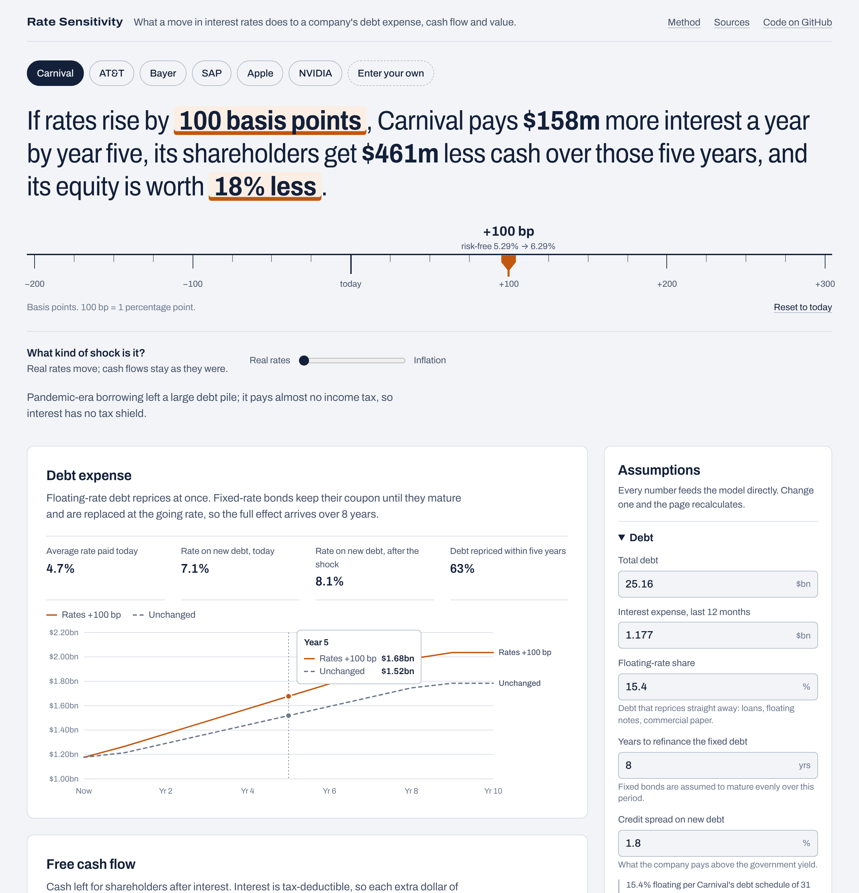

# Rate Sensitivity

An interactive tool that shows what a move in interest rates does to a company: its debt expense, the cash left for shareholders, and what the equity is worth.

**Live demo: [rate-sensitivity.vercel.app](https://rate-sensitivity.vercel.app/)**

Pick one of six real companies or type in your own numbers, drag the ruler to shock rates by anything from −200 to +300 basis points, and the page recalculates.



## What it answers

A rate rise reaches a company through three channels, and they work on very different timescales.

| Channel | What happens | How fast |
|---|---|---|
| Debt expense | Floating-rate debt reprices. Fixed-rate bonds keep their coupon until they mature and are refinanced at the new rate. | Years, set by the maturity ladder |
| Free cash flow | More interest after tax leaves less cash for shareholders. Interest earned on cash moves the other way. | Follows the debt |
| Valuation | The risk-free rate sits inside the cost of equity and the cost of debt, so every future cash flow is discounted harder. | Immediately |

The tool puts the three side by side, which makes a few things visible that a single number hides:

- **AT&T** carries far more debt than **Carnival**, but almost all of it is long-dated and fixed, so its interest bill barely moves in the first years.
- **Apple** holds more cash than debt. Higher rates *raise* its cash flow and still lower its value.
- **NVIDIA** has almost no interest bill and is rate-sensitive anyway, because most of its value comes from cash flows far in the future.
- Even with no shock at all, companies that borrowed cheaply before rates rose face a growing interest bill as that debt comes due.

## The model

All of it lives in [`src/lib/model.ts`](src/lib/model.ts) as pure functions with no UI dependencies.

**Debt expense.** Debt is held constant and rolled over at par.

```
interest(t) = debt × [ s(t) × (rf + spread + shock) + (1 − s(t)) × fixed coupon ]
s(t)        = floating + (1 − floating) × (t − ½) / refinancing years
```

The fixed coupon is not an input. It is backed out so that the blend of floating and fixed debt matches the average rate the company pays today. For Carnival this gives 4.24%, close to the roughly 4.2% balance-weighted coupon on the fixed-rate notes in its debt schedule.

**Free cash flow.** Reported free cash flow becomes unlevered cash flow by adding back net interest after tax. It grows at one rate for five years and fades to the long-run rate by year ten.

```
unlevered FCF  = FCF + (interest − cash × cash yield) × (1 − tax)
levered FCF(t) = unlevered FCF(t) − (interest(t) − cash × cash yield) × (1 − tax)
```

**Valuation.** A ten-year DCF on the unlevered stream with a Gordon-growth terminal value.

```
cost of equity = rf + β × equity risk premium
WACC           = E/V × cost of equity + D/V × cost of debt × (1 − tax)
equity value   = Σ FCF(t) / (1 + WACC)^t + terminal value − debt + cash
```

**Reverse DCF.** By default the five-year growth rate is solved so that the model reproduces today's market capitalisation. Results then read as a change against the current share price and do not rest on a growth forecast.

**Real rates or inflation.** A second slider sets how much of the shock is inflation the company can pass on through prices. That share is added to long-run growth, which offsets part of the higher discount rate.

## Limits

This is an educational model. The simplifications that matter most:

- The shock is parallel and permanent. Every maturity moves by the same amount and stays there.
- Credit spreads and the equity risk premium do not react, though in practice they often widen when rates jump.
- Demand does not react. Operating cash flow changes only through the inflation slider.
- Total debt includes lease liabilities, which do not reprice like bonds.
- Equity durations come out long, because the discount rate moves one-for-one with the shock. Read the valuation numbers as an upper bound for a pure real-rate shock.
- Long-run growth is capped at the risk-free rate, which puts a visible kink in the valuation curve for large rate cuts.

## Data

Company figures are trailing-twelve-month values from [StockAnalysis](https://stockanalysis.com), retrieved on 10 November 2026. Interest expense is derived from EBIT and reported interest cover.

| Input | Value | Source |
|---|---|---|
| USD risk-free rate | 5.29% | [Damodaran](https://pages.stern.nyu.edu/~adamodar/New_Home_Page/home.htm), 1 Nov 2026 |
| EUR risk-free rate | 3.26% | 10-year Bund, [Trading Economics](https://tradingeconomics.com/germany/government-bond-yield), 9 Nov 2026 |
| Equity risk premium | 4.41% | [Damodaran](https://pages.stern.nyu.edu/~adamodar/New_Home_Page/home.htm) implied premium, 1 Nov 2026 |
| Carnival floating share | 15.4% | [Carnival debt schedule](https://www.carnivalcorp.com/wp-content/uploads/2026/06/Debt-Schedule-as-of-May-31-2026.pdf), 31 May 2026 |
| Beta | Blume-adjusted | Raw five-year beta from StockAnalysis |

Some inputs are my estimates and are labelled as such in the app and in [`src/lib/companies.ts`](src/lib/companies.ts): credit spreads, the refinancing ladder, the floating share for every company except Carnival, Apple's interest expense (no longer reported separately) and Bayer's tax rate. All of them can be changed in the assumptions panel.

## Run it

```bash
npm install
npm run dev        # http://localhost:3000
npm test           # model unit tests
npm run build      # production build
```

Requires Node 20 or newer. The app is static and deploys to Vercel without configuration.

## Stack

Next.js (App Router), React and TypeScript. Charts are hand-written SVG; there is no charting library. The model is covered by Vitest unit tests that check each formula against a hand calculation and check that every bundled company calibrates to its market price.

```
src/
  lib/model.ts        the financial model
  lib/companies.ts    company data and market inputs, with sources
  lib/model.test.ts   unit tests
  components/         ruler, charts, assumptions panel
  app/                page, layout, styles
```

## License

MIT. Not investment advice.
